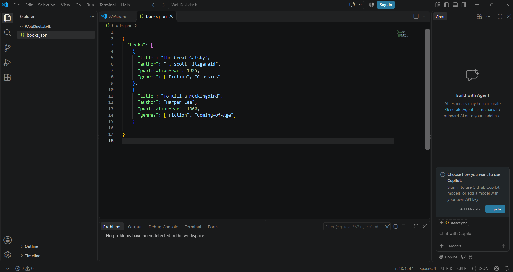
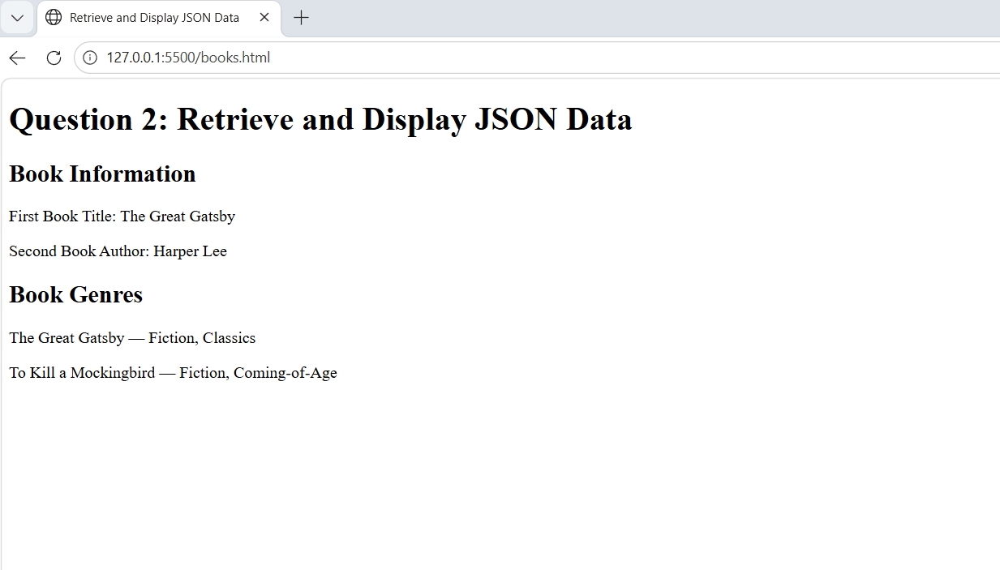
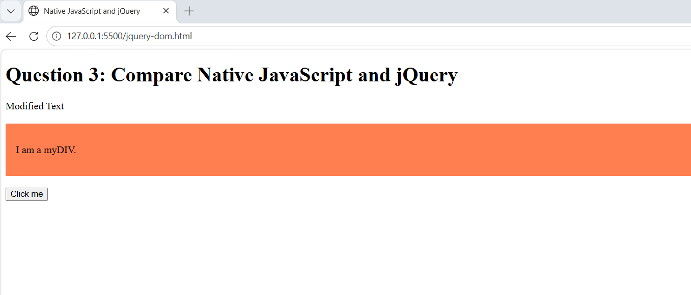
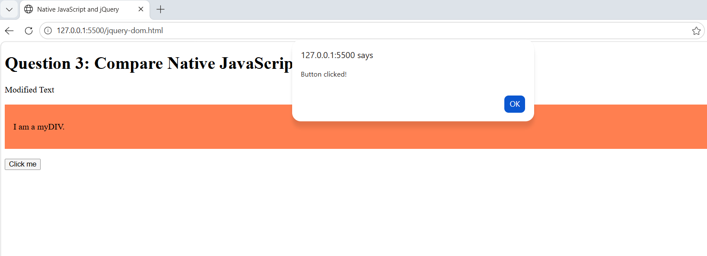

# BIC21203 Web Development – Lab 4b

**Name:** CHEONG YI PING  
**Student ID:** AI240114  
**Lab:** Lab 4b – Client-Side Scripting (JSON and jQuery)

## Description

This lab focuses on using JSON and jQuery in web development.
It includes creating JSON data, retrieving data using fetch(),
and using jQuery to modify HTML elements.

## Question 1: Create and Structure JSON Data

I created a books.json file containing information about
two books, including their titles, authors, publication
years, and genres.

## Question 2: Retrieve and Display JSON Data

I used the fetch() method to retrieve data from books.json
and display the book information on a webpage.

## Question 3: Compare Native JavaScript and jQuery

I used jQuery methods to change text, add a CSS class,
and handle a button click event.

## How to Run

1. Download or clone this repository.
2. Open the project folder in VS Code.
3. Start Live Server and open books.html to test Question 2.
4. Open books.json to view the JSON data for Question 1.
5. Open jquery-dom.html using Live Server to test Question 3.
6. An internet connection is needed to load jQuery from the CDN.

## Screenshots

### Question 1: JSON Data

### Question 2: Display JSON Data

### Question 3: jQuery Operations

**Text Modification and CSS Styling**

**Button Click Alert**

